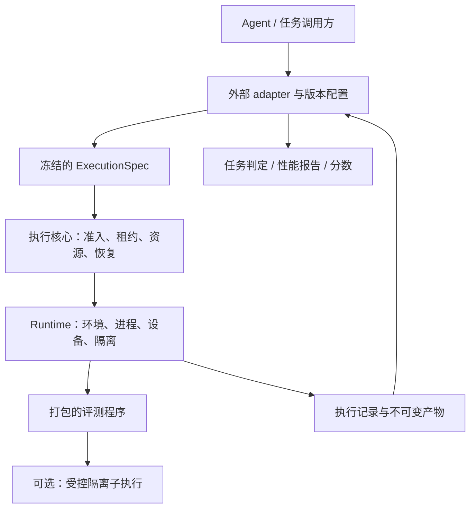

# 通用算子评测执行核心设计

状态：设计提案，尚未实现。日期：2026-11-06。代码基线：`bc22bac`。

后续修订：整体服务按[六项通用评测能力](capabilities.md)设计。本文主要保留执行底座细节；“执行内核不解释判定”不等于服务不能提供参数化比较/测量方法。benchmark adapter、profile 与评分仍在外部。

用户确认的方向：评测 adapter 在服务之外独立配置、开发和发布；底层支持不同任务的执行需求。本文确定职责、最小接口、扩展位置和迁移验收，不宣称现有服务已经具备这些能力。建议产品名为 **ascend-op-eval**。

## 1. 从执行事实出发

一次评测可以分解为：在明确的环境和资源上，运行明确的程序与材料，保存本次执行的事实。程序如何生成数据、调用候选、判断正确、测量性能和计分，由外部 adapter 决定。

核心抽象为：

```text
ExecutionSpec = Program + Inputs + RuntimeRequirements + Resources + Limits + Outputs
ExecutionSpec → durable execution → ExecutionRecord + Artifacts
Adapter(ExecutionRecord, Artifacts) → TaskEvaluation
```

这里的 Program 可以是编译脚本、完整 benchmark harness、profiler 驱动程序或自定义裁判。其业务逻辑和依赖由外部 adapter 打包；执行位置通常仍在 worker 上，因为输入生成、设备调用和计时需要接近硬件。adapter 在服务外部维护，不等于所有 adapter 代码都只能在客户端运行。

底层必须满足五条不变量：

1. 接受任务时冻结执行身份，执行前持久化；断连、重试、恢复不能改变原任务的含义。
2. 所有程序执行都属于有资源租约、截止时间和隔离范围的 attempt。
3. 程序执行结束、产物收集完成、算子判定通过是不同事实。
4. 环境、资源或隔离能力不满足请求时明确拒绝，不静默替换。
5. 新任务如果只改变计算或评测语义，应仅改变 adapter；需要底层新增的应是实际缺失的执行能力。

“普适”以能力组合为依据。它不意味着当前部署拥有任何硬件、编译器或跨机网络；不支持的能力必须可发现、可解释地拒绝。

## 2. 职责归属

| 模块 | 拥有的职责 | 不应拥有的任务规则 |
| --- | --- | --- |
| 外部 adapter | 任务协议；源码包装；构建命令；输入、seed、golden；输出结构与副作用契约；精度判定；计时方法；评分；报告解析；上游一致性验收 | 物理卡租约、其他任务的文件或进程、服务凭证 |
| 执行核心 | admission、幂等、队列、资源预留、期限、取消、attempt fencing、进程监督、产物保存、执行记录与恢复 | Triton/AscendC 校验、算子名称、容差、正确性门禁、benchmark 分数 |
| 服务通用方法 | 六项能力的可复用实现、方法参数校验、标准结果；复用同一执行内核 | CANNBench 专属 profile/defaults、格式转换及评分 |
| Runtime 模块 | 环境启动、文件与进程隔离、设备映射、资源限制、受控子执行、退出清理、工具运行能力 | CANNBench 特有任务和结果解释 |
| 部署管理 | 可用 runtime、镜像/工具链摘要、驱动、拓扑、权限与资源上限、卡健康恢复 | agent 的测试策略或任务评分 |

任务规则不能通过“通用字段”悄悄回到核心。例如 `requires_correctness_before_perf` 仍是 adapter 策略；底层只记录进程与资源事实。默认 adapter 可以继续提供现有 `/verify`、`/benchmark`、`/profile` 的使用体验。

## 3. 接口与模块关系



提供少量高层操作，底层隐藏租约、临时目录、设备映射和恢复细节：

| 操作 | 语义 |
| --- | --- |
| 查询 capabilities / runtimes | 返回实际支持的协议、环境摘要、资源类型、拓扑和隔离能力；不保证稍后仍有空闲容量 |
| 上传并封存 artifact | 对字节或文件树计算摘要；封存后不可原地修改；返回有访问控制的 artifact handle |
| submit execution | 验证和冻结 ExecutionSpec，持久化，返回原 instance 的恢复 handle |
| get execution / events | 获取状态、attempt 历史、基础设施观察和注明来源的程序进度 |
| cancel execution | 幂等请求取消；清理完成后才释放资源；终态任务不回退 |
| read artifacts | 按 handle、摘要、保留期读取日志、报告、二进制或 profiler 数据 |

HTTP 路径可以使用独立的 `/executions` 契约。确切路径与版本号在实现时定义，不能直接把当前 `/evaluations` 的 v2.1 JSON 改成不同含义。

## 4. ExecutionSpec

以下为说明性请求，不是当前可调用的接口，摘要均为占位符：

```json
{
  "contract": "execution-v1",
  "runtime": {"ref": "rt_immutable_handle", "digest": "sha256:<runtime>"},
  "program": {
    "artifact": "art_adapter_bundle",
    "digest": "sha256:<program-tree>",
    "argv": ["python3", "/program/main.py", "--config", "/inputs/config/run.json"]
  },
  "inputs": {
    "candidate": {"artifact": "art_candidate", "digest": "sha256:<candidate-tree>"},
    "task": {"artifact": "art_task", "digest": "sha256:<task-tree>"},
    "config": {"artifact": "art_config", "digest": "sha256:<config-tree>"}
  },
  "resources": {
    "cpu_cores": 8,
    "host_memory_bytes": 17179869184,
    "devices": {"kind": "ascend", "model": "ascend910_93", "count": 1},
    "placement": "single_host",
    "device_access": "exclusive"
  },
  "limits": {
    "deadline_seconds": 1800,
    "run_timeout_seconds": 1200,
    "scratch_bytes": 21474836480,
    "output_bytes": 1073741824,
    "log_bytes": 16777216,
    "processes": 64
  },
  "outputs": [
    {"name": "report", "path": "report.json", "required": true},
    {"name": "build_logs", "path": "build-logs", "required": false},
    {"name": "profile", "path": "profile", "required": false}
  ],
  "retry": {"max_attempts": 1},
  "labels": {"profile": "cannbench-a3-2.0"}
}
```

字段约束和含义：

- **Program** 是可执行文件树及 argv，可以选择环境内的 Python、shell 或原生可执行文件。不强制 `run()`、`ModelNew`、PyTorch 或任何 DSL；shell 行为必须通过显式的 `bash script.sh` 等命令表达，服务不拼接 shell 字符串。
- **Inputs** 是命名的不可变字节或文件树，挂载到 `/inputs/<name>`。Program 在 `/program` 只读；`/work` 为私有 scratch，`/outputs` 为产物区。服务不把输入强制转换成 tensor spec，也不加载 pickle 或导入候选来检查输入。
- **Runtime** 解析到部署认可的不可变描述，绑定镜像或受控 host runtime、挂载工具链摘要、CPU 架构、驱动约束和可用特性。它不等同于一个 Docker tag；宿主驱动和外部只读挂载也必须纳入记录。
- **Resources** 按实际资源申请，CPU-only 用 `devices.count=0`；不能再由 `checks=[compile]` 推导。显存容量要求与硬件匹配可以表达，但只有经 runtime 验证可强制执行时才声明显存硬限额能力。
- **Limits** 包含 admission 起算的总截止时间、运行起算的上限及整个进程树的预算。子执行共享父任务总预算，不能每启动一个子进程就重新获得完整预算。
- **Outputs** 定义从 `/outputs` 收集的命名结果及存在性要求，文件路径不能逃逸该目录。格式属于 adapter；缺文件是明确的收集观察，不自动推断为算子错误。
- **Labels** 便于检索，不授权、不调度、不证明兼容性。改变执行语义的配置必须进入有摘要的材料或规范字段，不能只藏在 label 中。

准入规范化后的执行字段、材料摘要、解析后的 runtime 身份和有效资源限制共同形成 request digest。同一 caller 的幂等键重放同一执行；同键不同语义冲突。标签、读取等待时长等不改变执行的元数据与语义身份分离。artifact 引用还必须验证调用方访问权，不能把知道摘要等同于有读取权限。

admission 为程序和输入建立持久引用，防止排队期间被 TTL 或垃圾回收删除；终态与保留期结束后释放。已接受任务所用 runtime 也须保留或明确失败，不能因 registry 中别名更新而换版本。新增环境通过部署侧的通用 runtime 注册流程提供，adapter 可以提出环境需求或交付镜像，但不能自行声明获得宿主权限。

## 5. 底层必须支持的执行能力

### 5.1 多文件、原生构建和安装

支持 `.py`、`.cpp`、`.asc`、头文件、构建脚本、wheel、动态库、数据文件和可执行文件。上传普通文件和受限目录树，固定摘要；归档解包限制路径、大小和条目数，服务不执行提交内的安装钩子进行“检查”。

构建和安装发生在 attempt 私有工作区或可写 runtime 层。依赖通过固定 runtime 或有摘要的输入提供。构建进程、编译器子进程和安装程序均受同一租约及预算约束；安装不能污染 worker 的共享 Python 环境或宿主 CANN。

一个 Program 可以自行完成 build → load → run → report。需要 CPU 构建与 NPU 测量分离时，外部 adapter 提交两个 execution，通过已封存的构建产物连接。底层先不引入任务 DAG、阶段恢复语言或算子专属 build 插件。

### 5.2 动态流程与多进程

循环、分支、随机输入、逐 case 调用、失败后继续或停止，由 Program 以正常代码表达。服务不需要预先知道 case 数量，也不把阶段名限定成 compile/correctness/performance/profile。

子进程、工作线程、编译进程和训练/通信 rank 都属于受控进程树；取消和租约失效必须清理整个隔离域，包括重新建 session 的后代。持续输出不能使服务内存无界增长；日志有 cursor、大小限制和明确截断标记。

### 5.3 独立执行状态与裁判隔离

两种执行方式都需要有明确的能力描述：

1. **整体运行模式**：完整上游 harness 在一个隔离域运行，内部如何导入候选由 harness 决定。适合保持上游行为。服务可以证明运行了哪些字节和收集了哪些输出，不能据此证明候选无法篡改同进程裁判。
2. **受控子执行模式**：外部 adapter 的 controller 在独立隔离域中，通过 attempt 范围的执行接口启动 candidate/reference 子执行。controller 可以保留 golden、输入快照和最终报告；候选只看到明确传入的数据与工作区。

受控子执行需要小的通用接口：`exec(CommandSpec) → process_handle`、`wait/cancel(process_handle)`、`seal_outputs(process_handle) → artifact_handles`。CommandSpec 只选择已授权环境、已有输入和已预留设备的子集；不得增加父任务预算、任意挂载宿主文件或获得服务管理权限。controller 的执行句柄不能传给 candidate 子执行。

父 Program 只有等所有子执行结束或被清理后才能完成该 attempt。子执行之间的资源分配也受父预留约束；独占测量不能与该任务的另一子执行意外重叠。封存输出前停止写入方或取得一致快照，收集时拒绝逃逸路径和符号链接，避免哈希期间内容继续改变。

这是核心的执行能力，不是服务端 benchmark adapter。它让不同 adapter 选择独立 reference、独立候选、隔离输入副作用或保护评分逻辑，而不要求修改核心。controller 自身仍是调用方程序；服务不默认认证它的判定规则。设备级内存和驱动隔离强度也应如实记录，不能仅凭“不同 Python 进程”宣称完全对抗隔离。

进程隔离不能丢掉评测语义：需要 alias/view、inplace 后状态、非连续布局或复合输出时，由 adapter 的数据交换协议保留。大数据通过本地文件、映射文件或经实现和验证的共享内存能力交换，不要求绕客户端下载重传。

### 5.4 资源和拓扑

资源模型从开始就支持设备列表、数量和拓扑约束，而不是单个 `device_id`：

- CPU-only：编译、数据预处理、CPU reference。
- 单卡：普通算子、流式/有状态算子、多 kernel 算子。
- 同机多卡：通信算子、collective、多 rank 程序；一组卡需要原子预留、整体清理。
- 多机：需要另行实现的资源组租约、网络/通信能力、协调启动和故障恢复。

第一版实现 CPU、单卡；同机多卡与受控子执行作为后续明确交付项。多机在实际支持前必须返回 `UNSUPPORTED_CAPABILITY`，不能把多个独立单卡任务伪装成一个 collective 评测。当前独立 instance 所有权保持；跨机协调是单独的执行能力扩展，不在首版暗改 Redis 架构。

capabilities 描述“能否支持”；admission 区分永不满足的能力要求和暂时繁忙，后者可按配额排队。实际启动前还要核验 runtime 和设备健康。租约过期不代表旧进程已停止：未确认清理完成的设备不能交给下一 attempt，应隔离并恢复。

### 5.5 测量和 profiler

具体方法和固定源码核对见 [AscendC / CANNBench 方法审查](../../research/cannbench-methods-review.md)与[skills / msprof 方法审查](../../research/cannbot-methods-review.md)。它们补充本文的执行抽象，方法规则仍由外部 adapter 持有。

核心提供独占资源、可用 profiler 工具、受控权限、进程和设备时间线、实际环境记录。计时窗口、warmup、repeat、stream 同步、cache 清理、kernel 归因、统计方法和正确性门禁属于 adapter Program。

核心的 wall time 是执行观察，绝不能自动作为 kernel latency。Event 时延、kernel-sum、端到端时延可以同时存在于 adapter 报告，不强制统一成一种数字。

独占一张卡不代表没有共享主机带宽或功耗影响；需要更强隔离时通过 host/device-group 独占能力申请。不支持的 profiler 权限或频率控制必须明确拒绝。实际频率、资源争用等可采集项注明来源和缺失情况，不保证两次测量逐位相等。

## 6. 执行事实、报告和失败语义

服务生成的 `ExecutionRecord` 至少包含：

- owner instance、execution/attempt ID、规范化请求摘要、服务/runtime 构建身份。
- 程序与全部输入摘要、实际 runtime/驱动/工具链、分配设备集合和隔离能力。
- 排队/启动/结束时间，主进程退出码或 signal，终止原因和资源观测。
- 输出清单：摘要、大小、类型、产出 attempt、收集状态、缺失/截断原因、保留期限。
- 每次 attempt 的结束原因；只有当前有效 attempt 可以发布最终结果。

程序可以输出任意结构的 `report.json` 或其他产物。服务不把其中的 `correct=true` 提升为自身认证；原样保存的报告注明 program 与 attempt 来源。即使 Program 为 `cannbench`，核心也不产生 `cannbench_compatible=true`。

| 观察 | 核心记录 | adapter 可以做的解释 |
| --- | --- | --- |
| 主程序正常退出，exit=0，报告说 wrong | `completed`，exit=0，报告产物 | 错误算子 |
| 编译器报错，Program exit=1 | `completed`，exit=1，编译日志 | 结合其协议判定 compile_error |
| 非服务取消/期限操作导致的进程 signal 终止 | `completed`，signal 与已收集产物 | 依据证据归因；不能只凭 signal 推断卡坏 |
| 正常结束但缺声明报告 | `completed`，`outputs.status=incomplete` | 无可用评测结论；不能算通过 |
| 宿主产物存储写入失败 | 保留退出事实，`outputs.status=failed` | 执行可能结束但证据不可恢复，不能算通过 |
| 无法启动 runtime、worker 丢失且恢复额度耗尽 | `failed`，具体基础设施原因 | 无评测结论 |
| 总截止时间或运行上限到达 | `timed_out`，终止阶段、清理情况、部分产物 | adapter 决定任务口径，核心不猜候选责任 |
| 调用方取消 | `cancelled`，已执行范围和清理情况 | 未完成评测 |

`completed` 表示主程序结束且输出收集已尝试完成，不代表 exit=0、输出齐全或语义正确。客户端必须分别检查 execution、termination 和 outputs。普通程序日志中的阶段名/进度属于 Program 声明；不能修改服务观察的资源状态或最终身份。

终态与取消竞态通过同一 fenced 状态机处理。终态结果与 artifact manifest 必须在持久化承诺内发布；大产物先封存，再提交终态引用。部分上传或失效 attempt 的文件不冒充最终产物，并有独立清理策略。

## 7. 恢复、缓存与可复现性

保留现有 admission-before-execution 和原 instance 恢复语义。幂等保证同一逻辑任务，不保证进程物理执行恰好一次。基础设施故障可能触发新 attempt，必须显示完整历史，不能混合旧 attempt 的测量与新 attempt 的报告。

默认不重试；调用方可设置有限的基础设施恢复额度。正常退出、signal 或算子报告失败不会因“希望得到通过结果”自动重试。重试重新匹配原来冻结的要求和 deadline，不能无声替换评测版本。网络默认关闭；需要网络的 execution 必须申请明确范围，重试可能重复外部副作用，无法提供 exactly-once 承诺。

核心只提供不可变 artifact 存取和去重。编译产物复用、reference 缓存、正确性复用和时延复用是否有效，由 adapter 负责完整的身份键和策略；核心不解析 benchmark 缓存。任何可复用产物都验证摘要和访问权，不能共享候选可写的构建目录。

数据摘要、随机配置和 runtime 身份能支持重放，不等于保证随机/并行计算数值完全确定，也不等于性能无波动。adapter 必须定义一致性标准。

## 8. 外部 CANNBench 配置如何落地

`cannbench-a3-2.0` 属于 adapter 的 profile registry，可以放在外部仓库配置中。它解析出：

```text
profile alias
  → adapter / 上游 harness 固定版本
  → 任务包、golden、基线、规则和参数摘要
  → runtime 描述与镜像摘要
  → 硬件、驱动、工具及资源要求
  → Program + Inputs + Outputs
```

配置解析结果在提交前冻结并作为输入保存。底层仅理解通用执行要求；alias 可以保存在 label 中。adapter 的版本、benchmark 数据包版本、CANN 版本、runtime 镜像版本、服务协议版本必须分别记录，不能都用 `2.0` 代替。

上游已有将 harness、tasks 与辅助代码冻结进镜像的模式，并将 A3 构建目标记为 `ascend910_93`，可用作 adapter 打包的参考：[CANNBench eval 镜像说明](https://gitcode.com/cann/cann-bench/blob/master/docker/eval/README.md)。这不证明某个自行构建的镜像等于网站实际部署，也不赋予任意 tag 官方含义。

对齐验收属于 adapter 项目：固定任务与输入分布、上游 revision、构建/执行环境、精度规则、测量方法、基线与评分；同一提交对照直接运行上游和经过服务运行的输出、失败分类与统计结果。只测试 happy path 不足以认证兼容性。无法取得隐藏 case 或网站精确配置时，声明已验证的公开快照范围；性能使用预先规定的统计容差。

## 9. 用不同任务检验设计

| 场景 | adapter 改变什么 | 底层所需能力 |
| --- | --- | --- |
| Triton 与 Torch 对比 | Python Program、输入和比较器 | 单卡、Python runtime、产物 |
| AscendC / ACLNN 工程 | 构建脚本、包安装、调用入口 | 原生工具链、私有可写层、进程树 |
| 不经 PyTorch 的 C++ 可执行程序 | 二进制输入输出协议、golden | 原生入口、文件树、设备映射 |
| sparse / ragged / tuple / dict / inplace | 数据编码、状态快照、输出契约 | 不限制 tensor 形式的 artifact 与隔离子执行 |
| 随机 / 近似 / 统计判定 | 多次采样、统计检验 | 长任务预算和动态流程 |
| 有状态 / 异步 / 多 stream | 进程内生命周期、同步和计时 | 常驻 Program、进程监督、工具能力 |
| 同机 collective | rank 启动、通信输入与判定 | 多卡原子预留、IPC/拓扑能力 |
| 特殊 profiler 或 sanitizer | 工具调用和报告解析 | 对应 runtime、权限与导出容量 |
| 新 benchmark 新评分 | 任务材料、harness、报告解释 | 核心无需添加 benchmark 分支 |

验收问题：把默认 Triton adapter 替换成 CANNBench adapter，核心是否只看到不同的材料摘要、程序和资源要求？如果必须在核心加入 `if benchmark == ...`、新的 tolerance 类型或 `ascendc` 候选枚举，模块拆分还未完成。

## 10. 当前实现如何迁移

| 当前实现 | 保留或改变 |
| --- | --- |
| [service/instance.py](../../../packages/ascend-op-eval/src/ascend_op_eval/control/instance.py)、[service/broker.py](../../../packages/ascend-op-eval/src/ascend_op_eval/control/broker.py) | 保留 durable admission、幂等、lease/fencing、owner recovery；存储结构从 check 专属结果转为 execution 记录，单独版本化 |
| [service/models.py](../../../packages/ascend-op-eval/src/ascend_op_eval/control/models.py) | 从 requested_checks 推导 CPU/NPU 的规则改为显式资源；worker compatibility 对齐 runtime capabilities，不绑定业务算法版本 |
| [runtime/worker.py](../../../packages/ascend-op-eval/src/ascend_op_eval/execution/worker.py) | evaluator 注入点改为 Program/runtime 执行；生命周期保留，资源从单卡扩展到设备集合 |
| [evaluators/base.py](../../../packages/ascend-op-eval/src/ascend_op_eval/evaluators/base.py) | 分离进程监督、日志、文件安全收集等通用实现；两段 Python 源码 materialize 改为 artifact staging |
| [runtimes/sandbox.py](../../../packages/ascend-op-eval/src/ascend_op_eval/runtimes/sandbox.py)、[runtime/health.py](../../../packages/ascend-op-eval/src/ascend_op_eval/resources/health.py) | 提取 Runtime 与设备管理模块；硬件健康检查由部署维护，不能取决于候选 DSL |
| [operator_input.py](../../../packages/ascend-op-eval/src/ascend_op_eval/operator_input.py)、[engine/](../../../packages/ascend-op-eval/src/ascend_op_eval/engine)、[evaluators/evaluation.py](../../../packages/ascend-op-eval/src/ascend_op_eval/evaluators/evaluation.py) | 任务输入转换、协议默认值和门禁迁入外部 adapter；可复用生成/比较/测量实现整理成服务通用方法，避免把已知验证缺陷固化 |
| [runtime/correctness_evidence.py](../../../packages/ascend-op-eval/src/ascend_op_eval/execution/correctness_evidence.py)、各 reference/baseline/verdict cache | 算子判定、复用键和语义校验归 adapter；核心保留 artifact 身份、权限和执行来源 |
| [api/contract.py](../../../packages/ascend-op-eval/src/ascend_op_eval/api/contract.py)、[api/routes.py](../../../packages/ascend-op-eval/src/ascend_op_eval/api/routes.py) | 新建 execution 契约；旧协议通过临时兼容入口或外部 gateway 翻译，核心不长期双持业务模型 |

迁移分四个可验收阶段：

1. **CPU 与单卡执行闭环**：artifact 上传/封存、runtime discovery、submit/get/cancel、原生 argv 执行、记录/日志/产物、超时与恢复。用无评测语义的 CPU 程序及真实 NPU 程序验收。
2. **两个真实 adapter**：现有 Triton 功能成为外部默认 adapter；CANNBench adapter 使用固定上游执行程序。先证明不同评测语义可共用接口，再补兼容入口。不将已有验证器缺陷作为迁移等价性的正确性背书。
3. **隔离与资源扩展**：受控子执行、同机多卡资源组、不同 runtime 间 artifact 传递、profiler 和共享数据通道；按真实任务验证。
4. **兼容与命名收敛**：旧任务保留原 owner、schema 和结果读取；逐步迁移调用方及存储命名。跨机执行单独立项，未实现前不宣称支持。

不能用旧记录填入新字段默认值来冒充新的执行证据。保留当前 Redis 数据和恢复能力，不在重命名时顺手改变 volume/prefix。更新执行语义需要独立的契约与存储版本，部署与 API 兼容测试必须覆盖切换。

## 11. 实现验收矩阵

- **契约独立性**：Python、原生二进制、Triton、AscendC、不同报告格式都使用相同执行契约；新增 adapter 不改核心枚举。
- **资源真实性**：不匹配环境拒绝；忙碌资源排队；CPU 任务没有设备；设备独占、多卡分配和清理符合请求；旧 attempt 未清理不复用卡。
- **执行生命周期**：重复提交、客户端断连、取消/完成竞态、worker 崩溃、lease 丢失、存储故障；只能当前 attempt 发布终态。
- **失败可解释性**：exit 0 + wrong、exit 1 + 编译报告、signal、超时、报告缺失、日志截断、收集失败分别保留事实。
- **构建与数据隔离**：两个同名扩展不互相污染；源码树只读、构建树私有；后代进程可清理；artifact 摘要及权限有效。
- **裁判能力**：受控子执行模式下 candidate 无法访问 controller 报告目录和凭证；两份输入状态独立且保留 adapter 声明的 alias/副作用语义。整体运行模式明确不提供同进程裁判隔离保证。
- **性能有效性**：服务不将 wall time 伪装成 kernel latency；验证实际 stream、多次同名 kernel、并行 launch 和 profiler 导出；比较直接运行与经过核心运行的测量分布。
- **上游一致性**：CANNBench adapter 独立维护正常/错误/编译失败/运行失败/部分 case 等对照用例与已验证版本。

本轮仅产出设计。尚未新增接口、移动实现、安装 runtime、更名项目或执行 NPU 验收。
